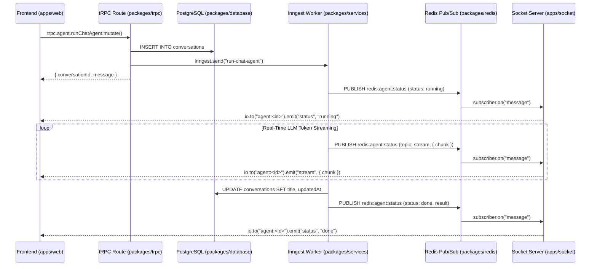

# Backend Agent Guidelines (`packages/*`, `apps/api`, `apps/socket`)

This document defines the architectural patterns, code style, backend standards, and workflows for AI coding agents modifying any backend package or service in this repository.

> [!IMPORTANT]
> **DOCUMENTATION MAINTENANCE**:
> Agents must update this `AGENTS.md` file whenever backend architecture, database schemas, tRPC routes, Redis channels, or Inngest background jobs change. Keep documentation concise and accurate.
>
> **PROHIBITION OF THIRD-PARTY BRAND NAMES (ZERO EXCEPTIONS)**:
> Agents must NEVER use third-party brand names (such as Notion, Eraser, Cal, Cal.com, Craft, etc.) anywhere in this project — including code, comments, documentation, UI strings, placeholders, file names, or variable identifiers. Always use generic terminology.

---

## 1. Architecture & Repository Map

```
├── apps/
│   ├── api/                  # Express HTTP server (:3000) hosting tRPC, Inngest & Auth
│   ├── mcp/                  # Remote FastMCP server (:9000) with OAuth 2.1 & tool definitions
│   └── socket/               # Standalone Socket.IO WebSocket server (:8080)
└── packages/
    ├── database/             # PostgreSQL schema (Drizzle ORM) & database migrations
    ├── error/                # Standard AppError class with typed error codes
    ├── logger/               # Shared structured logging utility
    ├── redis/                # Redis client and Pub/Sub connections (ioredis)
    ├── services/             # Core business logic layer (agent, auth, inngest, email, etc.)
    ├── socket/               # Socket.IO handlers and Redis event forwarding
    └── trpc/                 # tRPC procedures, context, middlewares, and routes
```

### Monorepo Workspaces & Package Names

- `@repo/database` (`packages/database`)
- `@repo/services` (`packages/services`)
- `@repo/trpc` (`packages/trpc`)
- `@repo/redis` (`packages/redis`)
- `@repo/socket` (`packages/socket`)
- `@repo/error` (`packages/error`)
- `@repo/logger` (`packages/logger`)

---

## 2. Core Backend Technologies

- **Runtime & Language**: Node.js, TypeScript (strict mode, zero type errors).
- **Database**: PostgreSQL 16 with Drizzle ORM (`pg` Pool driver).
- **Vector Database**: Qdrant (`@langchain/qdrant`) for RAG document chunk embedding and isolated similarity search.
- **API Protocol**: tRPC v11 with Express middleware adapter (`@trpc/server/adapters/express`).
- **Async Jobs**: Inngest (`inngest/index.ts`, `inngest.createFunction`) triggered by events.
- **Real-Time Communication**: Socket.IO (`apps/socket`) backed by Redis Pub/Sub (`@repo/redis/pubsub`).
- **AI Agent Engine**: LangGraph (`@langchain/langgraph`) with `PostgresSaver` checkpointing and LangSmith observability (`LANGSMITH_*` / `LANGCHAIN_*`).
- **Model Context Protocol (MCP)**: Remote FastMCP server (`apps/mcp`) with OAuth 2.1 authentication and `@langchain/mcp-adapters` for model tool/prompt bindings.

---

## 3. End-to-End Data & Execution Flow



---

## 4. How to Make Backend Changes

### A. Database Schema & Migration Workflow

1. **Edit or create models** in `packages/database/models/<table-name>.ts`.
2. **Export schemas** in `packages/database/models/index.ts` and `packages/database/schema.ts`.
3. **Generate migration SQL**:
   ```bash
   pnpm --filter @repo/database db:generate
   ```
4. **Apply migration to PostgreSQL**:
   ```bash
   pnpm --filter @repo/database db:migrate
   ```
5. **Always provide default values** for new non-null columns (e.g. `.default(false)`, `.defaultNow()`).
6. **MCP OAuth Schemas (`packages/database/models/mcp-oauth/`)**: Tables `oauth_clients`, `oauth_codes`, and `oauth_tokens` support RFC-compliant OAuth 2.1 client registration, authorization code grants with PKCE (`S256`), and refresh token management for the remote FastMCP server.

### B. Service Layer Workflow (`packages/services/`)

- All business logic lives in `packages/services/<domain>/index.ts`.
- **Pure Instance Methods Only (Prohibition of Static Wrappers)**: Service classes must define standard instance methods only. Never create duplicate `static` proxy methods or `private static instance` wrappers on service classes.
- **Service Instantiation in tRPC**: Services must be instantiated and exported as shared instances in `packages/trpc/server/services/index.ts` (e.g. `export const noteService = new NoteService();`). tRPC procedures and consumers must import and call these instances directly (e.g. `noteService.getWorkspace(...)`).
- **OAuth 2.1 Server Service (`packages/services/mcp-oauth/`)**: `OAuthServerService` manages authorization server workflows for remote MCP access: client registration, PKCE verification (`code_challenge` / `code_verifier`), authorization code exchange, refresh token lifecycles, and session access token generation.
- **Note Management & Flexible Hierarchy (`packages/services/notes/`)**: `NoteService` methods `createChapter` and `createPage` accept optional `notebookId` and `chapterId`, automatically defaulting to the active workspace container when omitted. `getBlocks` returns blocks ordered via natural alphanumeric sorting (`localeCompare` with `numeric: true`) and tie-breaks duplicate positions by creation timestamp (`createdAt`).
- Use `db` imported from `@repo/database`.
- Throw `AppError` from `@repo/error` for predictable application errors.
- Never write raw SQL where Drizzle query builder methods exist, except for external checkpoint/vector tables using `sql`.

### C. tRPC Route Workflow (`packages/trpc/`)

1. **Define DTO schema** in `packages/trpc/server/routes/<domain>/model.ts` with Zod:
   ```typescript
   export const updateItemDto = z.object({
     id: z.string().uuid(),
     name: z.string().trim().min(1),
   });
   export type updateItemDtoType = z.infer<typeof updateItemDto>;
   ```
2. **Add procedure** in `packages/trpc/server/routes/<domain>/route.ts`:
   - Use `protectedProcedure` for authenticated actions (`ctx.user.id`).
   - Use `publicProcedure` for unauthenticated endpoints.
   - Always wrap execution in `try / catch` and call `handleRouteError(error)`.
   - Agent procedures: `getUserMemories`, `createUserMemory`, `updateUserMemory`, `deleteUserMemory`, `getAvailableToolkits`, `getToolkitCategories`, `getUserConnectedAccounts`, `initiateToolkitConnection`, `disconnectToolkit`, `checkToolkitConnectionStatus`, `refreshUserConnectedAccounts`, `resumeChatAgent`.
   - Notes procedures (`packages/trpc/server/routes/notes/`): `getWorkspace`, `getNotebooks`, `createNotebook`, `updateNotebook`, `archiveNotebook`, `restoreNotebook`, `deleteNotebookPermanently`, `reorderNotebook`, `getChapters`, `createChapter`, `updateChapter`, `toggleFavoriteChapter`, `archiveChapter`, `restoreChapter`, `deleteChapterPermanently`, `reorderChapter`, `getPages`, `getPageById`, `createPage`, `updatePage`, `togglePinPage`, `movePage`, `archivePage`, `restorePage`, `deletePagePermanently`, `reorderPage`, `getBlocks`, `createBlock`, `updateBlock`, `deleteBlock`, `autosavePage`, `getDiagram`, `saveDiagram`, `deleteDiagram`, `getChapterFileDock`, `addDockFile`, `deleteDockFile`, `createDockFolder`, `deleteDockFolder`, `searchNotes`, `getTrash`, `getLinkPreview`.
   - **Notes System & Atomic Autosave (`packages/services/notes/`)**: `NoteService` provides complete workspace hierarchy management (notebooks, chapters, pages, blocks, diagrams, and chapter file docks). `autosavePage` performs atomic debounced batch reconciliation of page title, summary, and blocks in a single operation. The frontend autosave strategy couples a 1.5s Idle Debounce (1-2s window) with a 6s Max-Wait Throttle (5-10s window) to safeguard continuous typing against browser crashes or network dropouts. When new users initialize `/notes`, `getWorkspace` automatically provisions a default starter notebook, chapter, and blank page. Chapter file docks link directly to `file_docks` and `file_dock_files` to manage Cloudinary attachments, provisioning `file_docks` records on-demand using the chapter name only when a file is uploaded (without folder scaffolding).
   - **User Toolkit Connections & 24h Redis Caching**: User accounts connected to third-party services are managed via `ToolService` (`composio.connectedAccounts`) and cached in Redis under `redis:composio:user_connections:${userId}` with a 24-hour TTL (`86400`s). Initiating a connection, deleting a connection, or detecting an active status change automatically invalidates this key to keep connections synchronized.
   - **Tool Catalog & Isolated Semantic Search Namespaces**: Tool definitions for each toolkit are synced into LangGraph's `PostgresStore` under the per-toolkit namespace `tool-catalog-${toolkit}` with text embeddings for fast, isolated semantic search. If a toolkit is missing from the Postgres store during tool selection or connection resolution, tools are fetched from Composio and automatically synced into the store for subsequent semantic search queries.
   - **Tool Output Scaling (Pointer / Artifact Store & Autonomous Distillation)**: Large tool responses (>6,000 characters) are cached in Redis with a 24-hour TTL under `redis:agent:artifact:${artifactId}` to prevent data loss. `processToolOutput` distills the output using a fast model (`gpt-4o-mini`) tailored to the user's active query turn, providing key identifiers, matching items, and an artifact reference. The agent can page or filter the raw data via the built-in `INSPECT_TOOL_ARTIFACT` tool. In addition, `sanitizeToolOutput` serves as an in-memory circuit breaker that compacts arrays and hard-caps output strings to 15,000 characters.
   - **Remote Server MCP Tools & Encrypted Redis Token Passing**: When invoking or resuming the chat agent (`runChatAgent`, `resumeChatAgent`), user authentication tokens (`accessToken`, `refreshToken`) are extracted from tRPC cookies, encrypted with AES-256-CBC via `@repo/services/utils/encryption`, and stored in Redis under `redis:agent:tokens:${conversationId}` with a 5-minute TTL (`300`s). Inngest background events carry zero tokens to prevent credential leaks in event logs. The remote FastMCP server (`apps/mcp/src/server.ts`) registers domain tools including full notes management tools from `@repo/services/agent/mcp/tools/note` validated with strict Zod schemas for `BlockContent` and `blockType`, and the agent worker hydrates remote MCP tools using `MultiServerMCPClient` (`getMCPClient` / `getMCPServerTools` in `packages/services/agent/mcp/`) by decrypting the tokens, binding live tools to the model and `ToolNode`. Prompts, resources, and tool definitions from remote MCP servers are accessible on demand via introspection tools (`listPrompts`, `getPrompt`, `listResources`, `readResource`, `listTools`, `getTool`, `callTool` in `@repo/services/agent/tools/MCPTool`) bound to the agent in `llmCall`. Notes interactions enforce a mandatory protocol requiring the agent to call `get_mcp_prompt` (`notes_read_guidelines`, `notes_write_guidelines`, `notes_page_structure`) to retrieve structural schemas before executing read/write operations.
   - **Zuri MCP Tools Graph Node & Parallel Multi-Tool Execution**: The main agent graph includes `fetch_zuri_mcp_tools` at initialization to populate `state.zuriMcpTools` and self-heal checkpoints if an earlier execution terminated before tool responses were recorded. Internal Zuri MCP tools bypass `riskCheck` approval checks (`needs: false`) to prevent unnecessary human confirmation interrupts for first-party workspace operations. The LLM binds tools with `{ parallel_tool_calls: true }`, allowing the agent to emit and execute multiple tool calls simultaneously in `toolsNode` (`ToolNode` with `handleToolErrors: true` and parallel `processToolOutput`) for faster turn execution. If an MCP tool call fails to produce a response in `ToolNode`, `toolsNode` executes a direct fallback call against the remote FastMCP client. Graph execution runs with `recursionLimit: 150`, and `sanitizeMessageHistory` ensures every assistant `tool_calls` message is matched with corresponding `ToolMessage` instances before invoking LLM completions.
3. **Register routes** in `packages/trpc/server/routers/index.ts` under `serverRouter`.

### D. Inngest Background Jobs (`packages/services/inngest/`)

- Define functions using `inngest.createFunction` in `packages/services/inngest/`.
- Break execution into atomic, idempotent steps with `step.run("<step-id>", async () => ...)`.
- Emit updates to the frontend by publishing to Redis pub/sub (`publisher.publish("redis:agent:status", ...)`).
- **Document Ingestion & RAG**: If `fileUrls` are present in `run-chat-agent` event data, execute `step.run("ingest-documents")` to download and embed files or fetch YouTube video transcripts via `AgentService.ingestDocument` with `conversationId` and `userId` metadata before invoking `AgentService.chat` with `isFilesInclude: true`. Similarity search in `retrieve` filters chunks by `metadata.conversationId` to ensure conversation-isolated retrieval. When new files are attached in the active query turn, `crossFileComparisonJudge` determines if the query specifically refers to newly attached files or requires historical files; if not comparing, `retrieve` restricts the search to `metadata.source` matching the active turn's `targetFileUrls` to prevent previous files from contaminating the retrieval context. In `decideRag`, if the current query turn includes files, RAG is executed immediately and an optimized `ragQuery` is generated; if the query does not include files, the node checks if the conversation previously had files (via `state.messages` `additional_kwargs` and `redis:agent:conversation_has_files:${conversationId}`), executing `ragJudge` only when files exist in the conversation to evaluate requirement and generate `ragQuery`, bypassing it otherwise. When invoking `ragAgent` in `llmCall`, `state.ragQuery` is passed to power retrieval and context generation.
- **Uploaded Files Persistence**: `fileUrls` and `attachments` associated with each query turn are persisted in LangGraph's `PostgresSaver` checkpoints via `HumanMessage.additional_kwargs`. When loading conversations via `AgentService.getConversationMessages`, `fileUrls` and `attachments` are deserialized from checkpoints and returned with the corresponding user messages.
- **Human-in-the-Loop & Resume Execution**:
  - `runAgent` detects interrupts via LangGraph checkpoint inspection and publishes `{ status: "interrupted", interrupt }`.
  - `resumeAgent` listens to `"resume-chat-agent"` events (`conversationId`, `userId`, `resumeValue`), invoking `AgentService.resumeChat` with `Command({ resume: resumeValue })` and streaming chunks to Redis.
  - **Always-Allowed Tools Redis Caching**: When a user approves actions with an `"always"` verdict (in the `approve` node), the tool names are persisted in Redis under `redis:agent:allowed_tools:${userId}` (Redis Set). The `riskCheck` node queries this cache alongside `state.allowedTools` to automatically bypass approval for trusted actions across conversations.
- Export functions in `AgentFunction` array and ensure they are mounted in `inngestRouter`.

### E. Real-Time WebSockets (`packages/socket/` & `apps/socket/`)

- Redis channel contract: `redis:agent:status`.
- Message format:
  ```json
  {
    "jobId": "<conversationId>",
    "topic": "status" | "title" | "stream" | "connection_success",
    "payload": { ... }
  }
  ```
- Clients join rooms matching `agent:${jobId}` via socket event `join:agent`, and user rooms `user:${userId}` via `join:user`.
- Handlers in `packages/socket/agentSocket.ts` forward Redis messages to `io.to("agent:" + jobId).emit(topic, payload)` and `io.to("user:" + payload.userId).emit(topic, payload)`.

### F. Composio Webhook (`apps/api`)

- Route: `/webhook/composio` and `/api/webhook/composio`.
- When an account connection status updates (`ACTIVE` / `CONNECTED`):
  1. Invalidates Redis cache `redis:composio:user_connections:${userId}`.
  2. Publishes `connection_success` topic to `redis:agent:status`.
  3. Checks `redis:agent:waiting_connection:${userId}`. If an agent is waiting, automatically triggers Inngest event `"resume-chat-agent"` with `{ status: "connected" }` to resume graph execution seamlessly.

---

## 5. Error Handling Standard

Always throw `AppError` from `@repo/error` in services:

```typescript
import { AppError } from "@repo/error";

// Example
if (!conversation) {
  throw new AppError("NOT_FOUND", "Conversation not found");
}
```

Supported `AppError` codes:

- `"BAD_REQUEST"`
- `"UNAUTHORIZED"`
- `"FORBIDDEN"`
- `"NOT_FOUND"`
- `"CONFLICT"`
- `"INTERNAL_SERVER_ERROR"`

`handleRouteError` in `packages/trpc/server/utils/error.ts` automatically converts `AppError` and Zod errors to native tRPC errors with corresponding HTTP status codes.

---

## 6. Code Style & Comment Standards

- **Comment Style**:
  - All comments must follow a clean, single-line format: `// <Comment>` (e.g. `// Hook`, `// Check nested result object`, `// Step 1: publish running status`).
  - No extra or verbose comments. Avoid decorative divider banners (`// ──── ... ────`) and multi-line JSDocs.
  - Do not comment self-explanatory lines of code.
- **Strict Typing**:
  - Avoid `any` whenever possible.
  - Validate and infer types using Zod schemas for all network inputs.
  - Run typechecks to verify zero compile errors:
    ```bash
    pnpm --filter @repo/services exec tsc --noEmit
    pnpm --filter @repo/trpc exec tsc --noEmit
    pnpm --filter @repo/database exec tsc --noEmit
    ```
- **Environment Variables**:
  - Always validate environment variables in each package's `env.ts` using Zod.
  - Never access `process.env` directly outside configuration/env files.
  - **LangSmith Tracing**: Set `LANGSMITH_TRACING=true`, `LANGSMITH_API_KEY`, and `LANGSMITH_PROJECT` in `apps/api/.env`. `packages/services/env.ts` automatically populates bidirectional `LANGCHAIN_*` aliases (`LANGCHAIN_TRACING_V2`, `LANGCHAIN_API_KEY`, `LANGCHAIN_PROJECT`) to ensure compatibility across all LangChain and LangGraph runtimes.
