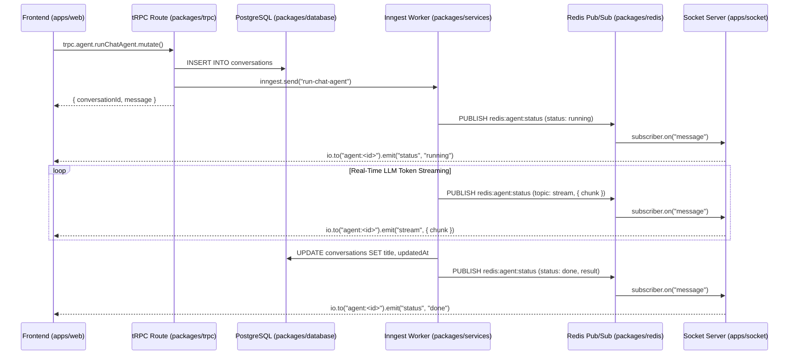

# Backend Agent Guidelines (`packages/*`, `apps/api`, `apps/socket`)

This document defines the architectural patterns, code style, backend standards, and workflows for AI coding agents modifying any backend package or service in this repository.

> [!IMPORTANT]
> **DOCUMENTATION MAINTENANCE**:
> Agents must update this `AGENTS.md` file whenever backend architecture, database schemas, tRPC routes, Redis channels, or Inngest background jobs change. Keep documentation concise and accurate.

---

## 1. Architecture & Repository Map

```
├── apps/
│   ├── api/                  # Express HTTP server (:3000) hosting tRPC, Inngest & Auth
│   └── socket/               # Standalone Socket.IO WebSocket server (:8080)
└── packages/
    ├── database/             # PostgreSQL schema (Drizzle ORM) & database migrations
    ├── error/                # Standard AppError class with typed error codes
    ├── logger/               # Shared structured logging utility
    ├── redis/                # Redis client and Pub/Sub connections (ioredis)
    ├── services/             # Core business logic layer (agent, auth, inngest, email, etc.)
    ├── socket/               # Socket.IO handlers and Redis event forwarding
    └── trpc/                 # tRPC procedures, context, middlewares, and routes
```

### Monorepo Workspaces & Package Names

- `@repo/database` (`packages/database`)
- `@repo/services` (`packages/services`)
- `@repo/trpc` (`packages/trpc`)
- `@repo/redis` (`packages/redis`)
- `@repo/socket` (`packages/socket`)
- `@repo/error` (`packages/error`)
- `@repo/logger` (`packages/logger`)

---

## 2. Core Backend Technologies

- **Runtime & Language**: Node.js, TypeScript (strict mode, zero type errors).
- **Database**: PostgreSQL 16 with Drizzle ORM (`pg` Pool driver).
- **Vector Database**: Qdrant (`@langchain/qdrant`) for RAG document chunk embedding and isolated similarity search.
- **API Protocol**: tRPC v11 with Express middleware adapter (`@trpc/server/adapters/express`).
- **Async Jobs**: Inngest (`inngest/index.ts`, `inngest.createFunction`) triggered by events.
- **Real-Time Communication**: Socket.IO (`apps/socket`) backed by Redis Pub/Sub (`@repo/redis/pubsub`).
- **AI Agent Engine**: LangGraph (`@langchain/langgraph`) with `PostgresSaver` checkpointing and LangSmith observability (`LANGSMITH_*` / `LANGCHAIN_*`).

---

## 3. End-to-End Data & Execution Flow



---

## 4. How to Make Backend Changes

### A. Database Schema & Migration Workflow

1. **Edit or create models** in `packages/database/models/<table-name>.ts`.
2. **Export schemas** in `packages/database/models/index.ts` and `packages/database/schema.ts`.
3. **Generate migration SQL**:
   ```bash
   pnpm --filter @repo/database db:generate
   ```
4. **Apply migration to PostgreSQL**:
   ```bash
   pnpm --filter @repo/database db:migrate
   ```
5. **Always provide default values** for new non-null columns (e.g. `.default(false)`, `.defaultNow()`).

### B. Service Layer Workflow (`packages/services/`)

- All business logic lives in `packages/services/<domain>/index.ts`.
- Service classes must provide both `static` and instance methods for clean caller flexibility.
- Use `db` imported from `@repo/database`.
- Throw `AppError` from `@repo/error` for predictable application errors.
- Never write raw SQL where Drizzle query builder methods exist, except for external checkpoint/vector tables using `sql`.

### C. tRPC Route Workflow (`packages/trpc/`)

1. **Define DTO schema** in `packages/trpc/server/routes/<domain>/model.ts` with Zod:
   ```typescript
   export const updateItemDto = z.object({
     id: z.string().uuid(),
     name: z.string().trim().min(1),
   });
   export type updateItemDtoType = z.infer<typeof updateItemDto>;
   ```
2. **Add procedure** in `packages/trpc/server/routes/<domain>/route.ts`:
   - Use `protectedProcedure` for authenticated actions (`ctx.user.id`).
   - Use `publicProcedure` for unauthenticated endpoints.
   - Always wrap execution in `try / catch` and call `handleRouteError(error)`.
   - Agent memory management procedures: `getUserMemories`, `createUserMemory`, `updateUserMemory`, `deleteUserMemory`.
3. **Register routes** in `packages/trpc/server/routers/index.ts` under `serverRouter`.

### D. Inngest Background Jobs (`packages/services/inngest/`)

- Define functions using `inngest.createFunction` in `packages/services/inngest/`.
- Break execution into atomic, idempotent steps with `step.run("<step-id>", async () => ...)`.
- Emit updates to the frontend by publishing to Redis pub/sub (`publisher.publish("redis:agent:status", ...)`).
- **Document Ingestion & RAG**: If `fileUrls` are present in `run-chat-agent` event data, execute `step.run("ingest-documents")` to download and embed files via `AgentService.ingestDocument` with `conversationId` and `userId` metadata before invoking `AgentService.chat` with `isFilesInclude: true`. Similarity search in `retrieve` filters chunks by `metadata.conversationId` to ensure conversation-isolated retrieval.
- **Uploaded Files Persistence**: `fileUrls` and `attachments` associated with each query turn are persisted in LangGraph's `PostgresSaver` checkpoints via `HumanMessage.additional_kwargs`. When loading conversations via `AgentService.getConversationMessages`, `fileUrls` and `attachments` are deserialized from checkpoints and returned with the corresponding user messages.
- Export functions in `AgentFunction` array and ensure they are mounted in `inngestRouter`.

### E. Real-Time WebSockets (`packages/socket/` & `apps/socket/`)

- Redis channel contract: `redis:agent:status`.
- Message format:
  ```json
  {
    "jobId": "<conversationId>",
    "topic": "status" | "title" | "stream",
    "payload": { ... }
  }
  ```
- Clients join rooms matching `agent:${jobId}` via socket event `join:agent`.
- Handlers in `packages/socket/agentSocket.ts` forward Redis messages to `io.to("agent:" + jobId).emit(topic, payload)`.

---

## 5. Error Handling Standard

Always throw `AppError` from `@repo/error` in services:

```typescript
import { AppError } from "@repo/error";

// Example
if (!conversation) {
  throw new AppError("NOT_FOUND", "Conversation not found");
}
```

Supported `AppError` codes:

- `"BAD_REQUEST"`
- `"UNAUTHORIZED"`
- `"FORBIDDEN"`
- `"NOT_FOUND"`
- `"CONFLICT"`
- `"INTERNAL_SERVER_ERROR"`

`handleRouteError` in `packages/trpc/server/utils/error.ts` automatically converts `AppError` and Zod errors to native tRPC errors with corresponding HTTP status codes.

---

## 6. Code Style & Comment Standards

- **Comment Style**:
  - All comments must follow a clean, single-line format: `// <Comment>` (e.g. `// Hook`, `// Check nested result object`, `// Step 1: publish running status`).
  - No extra or verbose comments. Avoid decorative divider banners (`// ──── ... ────`) and multi-line JSDocs.
  - Do not comment self-explanatory lines of code.
- **Strict Typing**:
  - Avoid `any` whenever possible.
  - Validate and infer types using Zod schemas for all network inputs.
  - Run typechecks to verify zero compile errors:
    ```bash
    pnpm --filter @repo/services exec tsc --noEmit
    pnpm --filter @repo/trpc exec tsc --noEmit
    pnpm --filter @repo/database exec tsc --noEmit
    ```
- **Environment Variables**:
  - Always validate environment variables in each package's `env.ts` using Zod.
  - Never access `process.env` directly outside configuration/env files.
  - **LangSmith Tracing**: Set `LANGSMITH_TRACING=true`, `LANGSMITH_API_KEY`, and `LANGSMITH_PROJECT` in `apps/api/.env`. `packages/services/env.ts` automatically populates bidirectional `LANGCHAIN_*` aliases (`LANGCHAIN_TRACING_V2`, `LANGCHAIN_API_KEY`, `LANGCHAIN_PROJECT`) to ensure compatibility across all LangChain and LangGraph runtimes.
